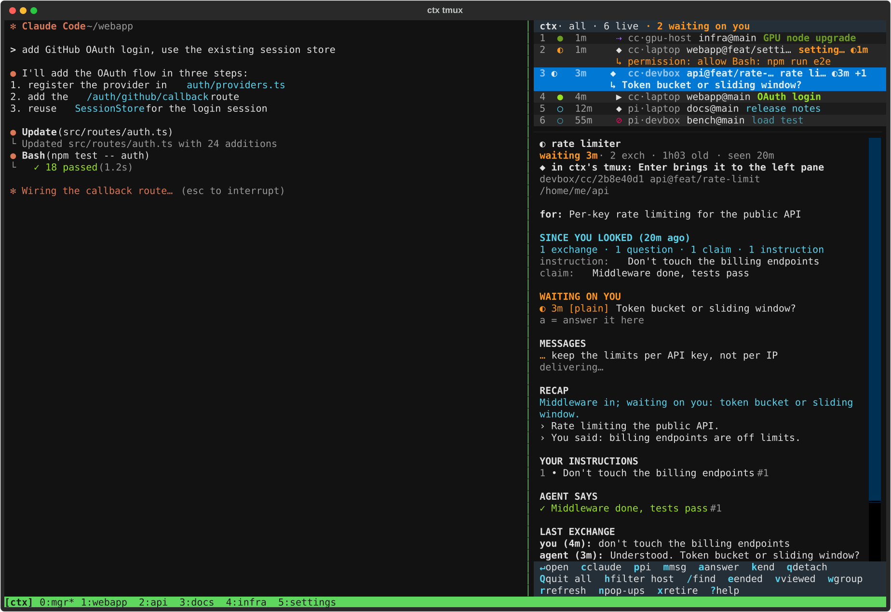
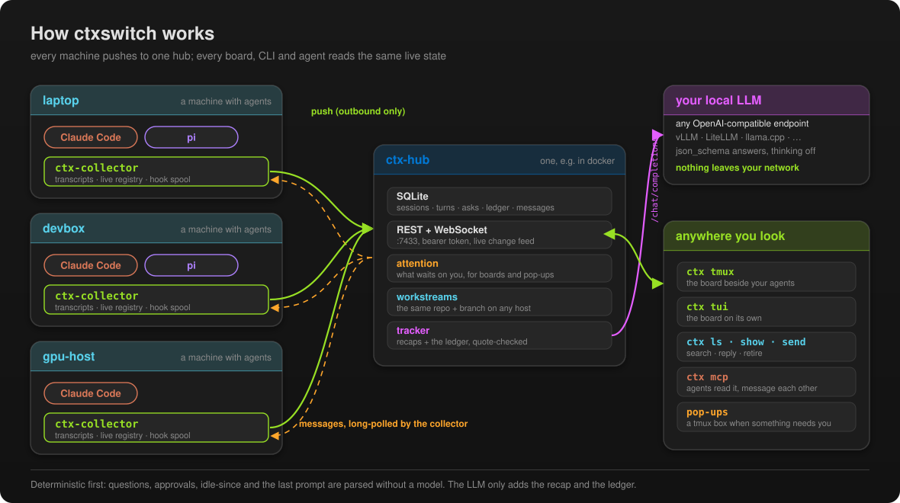
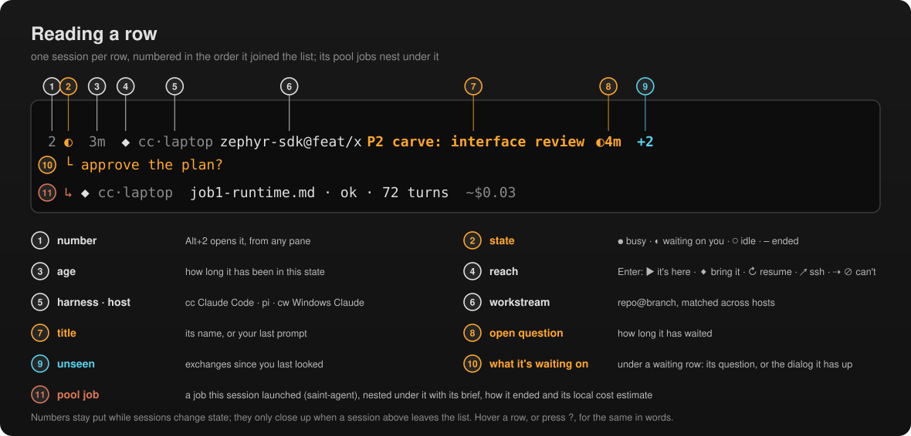
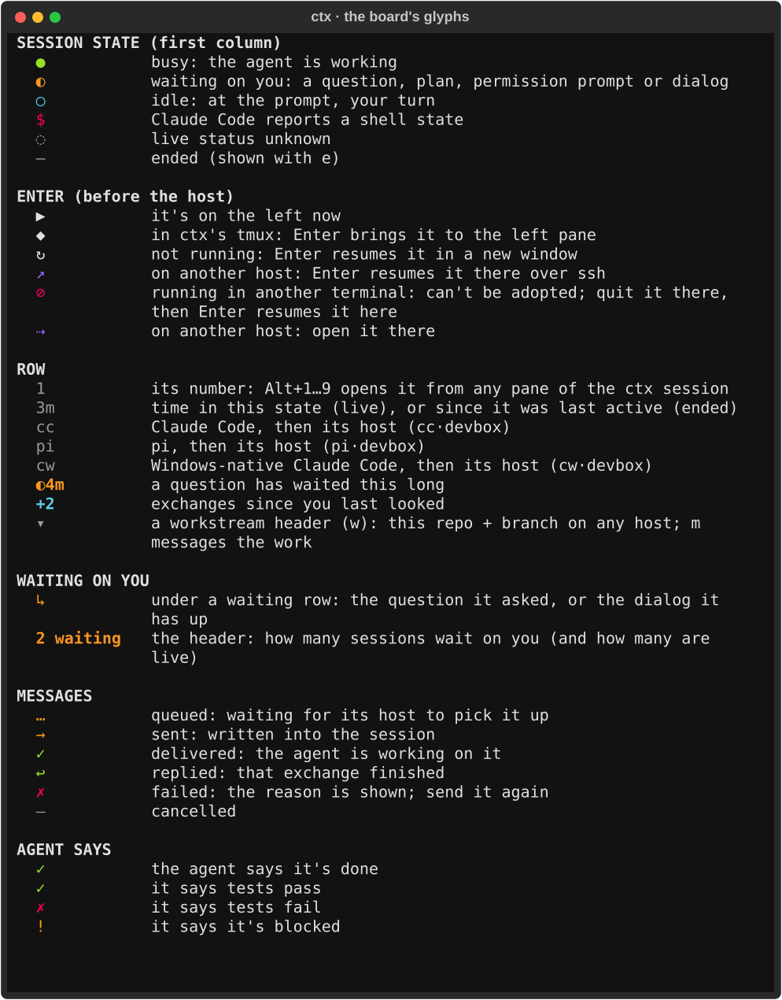
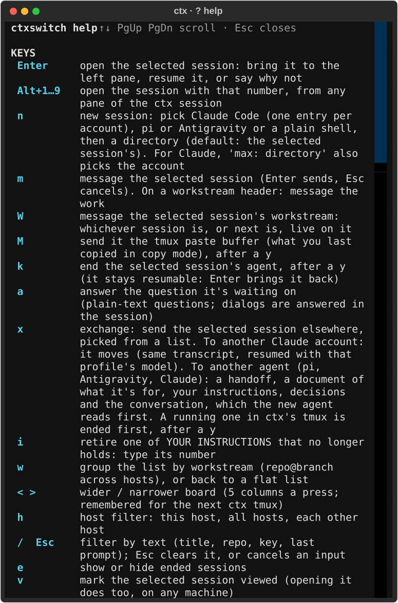
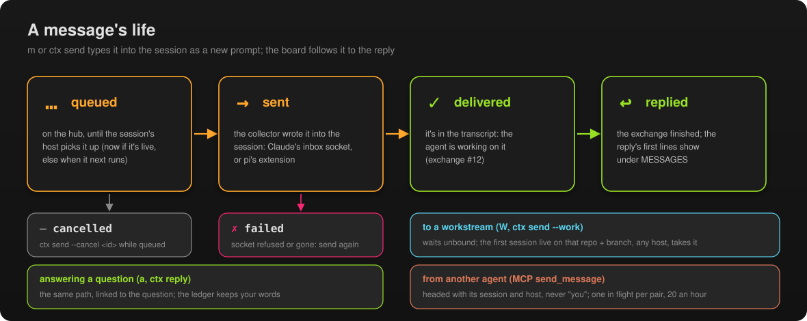

<h1 align="center">ctxswitch</h1>

<p align="center"><b>Short-term memory for people who run a lot of coding agents at once.</b></p>

<p align="center">
  
  
  
  
  
</p>

<p align="center"></p>

If you keep a dozen Claude Code, pi and Antigravity sessions going across a few machines, the hard part stops being the code.
It becomes remembering, every time you switch back to one: *what was this session for, what did I tell it, what
did I already answer, and what is it waiting on right now?* ctxswitch keeps that for you, live, and shows it
in one narrow board next to whatever you're doing.

Above: you're working with the OAuth session on the left (`▶`). On the right, every session on every machine,
numbered so `Alt+N` jumps to it. Two are waiting on you, and each says for what (`↳`): a permission prompt, and a
question the rate-limiter session asked. Selected, that one shows what it's for, what you told it ("don't touch the
billing endpoints"), what it claims, its recap, and a message you've queued for it. The image is the real board,
rendered by [scripts/screenshots.py](scripts/screenshots.py) from made-up sessions.

## What it does
- **Watches every session on every machine.** It reads Claude Code and pi transcripts as they are written, and
  Google Antigravity's conversation store, so capture is automatic. Nothing depends on an agent remembering to
  call a tool.
- **Tracks the human↔agent conversation, not the code.** For each session it keeps your last prompt, the agent's
  last reply, the questions it asked and your verbatim answers, the plan approvals, a tool tally, and whether it
  is busy, idle, waiting on you or ended.
- **Says what's waiting on you.** A session waiting on a question, plan approval, permission prompt ("allow Bash:
  rm -rf build") or pi confirm dialog says so under its row, and the header counts them. Each clears itself when
  you answer.
- **Writes a one-line recap per session**, so you know what matters right now, and keeps a ledger of what you
  told it: your standing instructions ("don't push without asking"), the choices you made, what the agent claims
  (done, tests pass, blocked) and what the session is for. Every ledger row quotes the transcript word for word.
  Both come from a *local* LLM seat. Nothing leaves your network.
- **Switches sessions for you.** Inside tmux, Enter (or Alt+1…9, by the row's number) swaps a session into the
  main pane, resumes an ended one, or says why it can't (running in another terminal, or on another host). `n`
  starts a new session (Claude per account, pi or Antigravity), `k` ends one. When an agent exits, the next one
  takes its place.
- **Messages a session from anywhere.** `m` (or `ctx send`) types a message into a live Claude or pi session on
  any machine, or queues it for an ended one until it next runs. The board follows it from queued to delivered
  to the agent's reply. `a` (or `ctx reply`) answers the question a session is waiting on, and the ledger
  records your answer as you typed it.
- **Pops up what's new.** When a session asks you something, a box pops up over your tmux panes.
- **Says what changed since you last looked.** Each row shows `+N` for the exchanges you haven't seen, and the
  detail pane lists the new ones.
- **Links the same work across machines.** Sessions on the same repo and branch (on any host) are one
  workstream. `w` groups the board by workstream, and each session lists the others with what you told them.
- **Briefs you when you come back.** Resume a session you left more than 15 minutes ago (`claude --resume`,
  `pi --session`) and it prints a short card first: how long you were away, what it's for, the recap, your
  standing instructions, your last prompt, the agent's last reply and any questions still open. It's shown to you, not sent to the model.
- **One source of truth.** A central hub holds all state. Every TUI on every machine shows the same thing,
  filterable by this host, a named host or all hosts. `ctx tui` opens on this host; `h` cycles the filter
  (the header shows which), or start with `ctx tui --all`.

## How it works
<p align="center"></p>

- **Collectors only connect outbound.** A machine that blocks inbound traffic still takes part fully. While
  the hub is unreachable, a local queue buffers events and replays them idempotently.
- **Deterministic first.** Anything the harness states outright (questions, approvals, idle-since, the last
  prompt) is parsed without a model, and a model never overwrites it. The LLM only adds interpretation, such as
  the recap.
- The design, phases and verified harness facts are in [DESIGN.md](DESIGN.md). Protocol spikes are in
  [spikes/SPIKES.md](spikes/SPIKES.md).

## Status
Working and in daily use on three machines. Phases 0–6 of [DESIGN.md](DESIGN.md) are done: the hub, collectors,
Claude hooks and the pi extension, the Antigravity reader, the board and tmux manager, the local-LLM tracker (recaps and the ledger),
messaging (to a session, a workstream, or as an answer), cross-host resume, pop-ups, `ctx search` and the MCP
server. Not done: Phase 7 (hub backups, token rotation, TLS) and Phase 8 (experimental drift/re-ask flags).

# User guide

## 1. Install

### One machine (try it out)
Needs Python ≥ 3.12, [uv](https://docs.astral.sh/uv/) and, for the manager, tmux.
```sh
git clone https://github.com/rickmellor/ctxswitch.git ~/repos/ctxswitch && cd ~/repos/ctxswitch
uv sync --extra test
.venv/bin/ctx-hub &                 # hub on http://127.0.0.1:7433, db in ~/.local/share/ctxswitch/hub.db
.venv/bin/ctx-collector --once      # index your transcripts, push them, exit
.venv/bin/ctx ls                    # you should see your recent sessions
```
Recaps and the ledger need a local LLM (see [6. The tracker](#6-the-tracker-recaps-and-ledger)); without one the
board works on everything else.
Put `.venv/bin` on your `PATH` (or symlink `ctx` into `~/.local/bin`) so plain `ctx` works.

### Several machines
1. **Pick a hub host.** It must be reachable from every other machine. Docker is the easy route:
   ```sh
   cat > deploy/.env <<'ENV'                      # untracked; stays on this host
   CTXSWITCH_HUB_TOKEN=<a long random string>
   CTXSWITCH_SEAT_URL=http://<llm-host>:4000/v1   # the tracker LLM (see 6. The tracker)
   CTXSWITCH_SEAT_MODEL=<model name>              # optional (default saint-local-text)
   CTXSWITCH_SEAT_API_KEY=<key>                   # optional (default "local")
   ENV
   docker compose -f deploy/compose.yml up -d --build
   ```
   The SQLite db lives in the `ctxswitch-data` volume and survives rebuilds.
2. **On every machine with agent sessions**, clone the repo to `~/repos/ctxswitch` and run
   ```sh
   deploy/install-collector.sh --hub http://<hub-host>:7433 --token <the hub token>
   ```
   It installs uv if needed, builds the venv, then runs `ctx install` (see below). The host's short name
   (`host_id`) defaults to its hostname; change it in `~/.config/ctxswitch/config.toml` if you like.
   Run `loginctl enable-linger $USER` so the collector keeps running when you log out.
3. **Check:** `ctx doctor` on each machine, and `ctx hosts` to see every collector the hub has heard from.

### What `ctx install` changes
| Part | Change | Undo |
|---|---|---|
| config | writes `~/.config/ctxswitch/config.toml` (mode 600, it holds the token) if `--hub`/`--token` are given or it's missing | delete it |
| collector | writes `~/.config/systemd/user/ctx-collector.service` pointing at this venv, enables and restarts it | `ctx uninstall --collector` |
| Claude Code | adds one `async` hook per event to `~/.claude/settings.json` (or `$CLAUDE_CONFIG_DIR`), keeping your other hooks; backs the original up to `~/.local/state/ctxswitch/backup/` | `ctx uninstall --claude` restores the original byte-for-byte, or removes just our entries if the file changed since |
| pi | symlinks `~/.pi/agent/extensions/ctxswitch.ts` to the extension in this repo | `ctx uninstall --pi` |
| MCP (only with `--mcp`) | `claude mcp add -s user ctxswitch -- <venv>/bin/ctx mcp` (replacing one that points at another venv), and symlinks `~/.claude/skills/ctxswitch` to the skill in this repo | `ctx uninstall --mcp` |

Pick parts with `--claude`, `--pi`, `--collector` (`--mcp` is never part of the default: see Agents); `--dry-run` shows what would change. Running it again is
safe. New pi sessions load the extension; restart running Claude sessions to be sure they have the hooks.

The hooks never block or slow an agent: they run in the background, exit 0 whatever happens, and only write a
small file to `~/.local/state/ctxswitch/spool/` (tool calls are only recorded while a permission prompt is
open). Without hooks ctxswitch still works from transcripts alone; you just don't see permission prompts.

Collectors only make outbound connections, so a machine behind a firewall that drops inbound traffic works
fine. If the hub goes away, collectors queue locally and catch up when it comes back.

## 2. Daily use: the tmux manager
```sh
ctx tmux             # create or re-attach the "ctx" tmux session (and put the board back if it's gone)
ctx tmux --restart   # restart the board on new code; your agents keep running
ctx tmux --width 40  # TUI width as columns or a percentage like 25% (default 60 columns)
```
You get one tmux window with two panes: **the session you're working in on the left**, the **board on the
right**. Every agent session lives in its own tmux window behind the scenes, and the board swaps whichever one
you pick into the left pane. Nothing is killed when you switch, and everything keeps running if your terminal
closes. `ctx tmux` brings it all back.

Move focus between the panes with tmux's prefix + arrow (or the mouse, if tmux mouse mode is on).

## 3. Reading the board
From top to bottom:

**Header.** One line: the host filter (`h`), how many sessions are live, and how many are waiting on you.

**Session list.** One row per session, numbered. A session keeps the place it had when it joined the list (new
ones go at the bottom), so its number, and the Alt+N that opens it, stays put while sessions change state. Numbers
only close up when a session above leaves the list: it ends (and ended ones are hidden), the hub drops it, or `h`
or `/` filters it out. One that leaves and comes back joins at the bottom. A session waiting on you gets a second
line saying what it's waiting on:

<p align="center"></p>

<p align="center"></p>

| State | Meaning |
|---|---|
| `●` green | busy: the agent is working |
| `◐` yellow | waiting on you: an open question, plan approval, permission prompt or dialog |
| `○` cyan | idle: at the prompt, your turn |
| `$` | Claude Code reports a shell state |
| `◌` | live status unknown |
| `–` dim | ended (hidden until you press `e`) |

| Reach | Enter… |
|---|---|
| `▶` | it's already on the left |
| `◆` | brings it to the left pane (it's in ctx's tmux) |
| `↻` | resumes it (`claude --resume` / `pi --session`) in a new window, then brings it left |
| `⊘` | can't: it's running in a terminal outside tmux. Quit it there, then Enter resumes it here |
| `↗` | it ended on another host: resumes it there over ssh, in a new window here (see `[ssh]`) |
| `⇢` | can't: it's live on another host, or there's no ssh route to it. The detail pane says which and what to run |

**Detail pane** for the selected session:
- the title, state and age, number of exchanges, and when you last looked (`seen 2h`);
- what Enter will do with it, the session key, repo, working directory, model and permission mode;
- **for:** what the session is for (from the tracker; it changes only when your goal does);
- **SINCE YOU LOOKED**: what's new since you last opened it (on any machine): how many exchanges, and the
  decisions, claims and instructions they added. Not shown before you've opened it once. The list row's `+N` is
  the same count;
- **WAITING ON YOU**: every open question, approval or prompt, verbatim, with how long it's been waiting.
  Kinds: `question`, `plan`, `permission` (Claude wants to run a tool), `elicitation` (an MCP server wants
  input), `prompt` (a pi dialog), `plain` (its reply ended in a question), `text` (the tracker read a question
  in its reply). Underneath: `a = answer it here`, or why you have to answer in the session;
- **RECAP**: one line on where it stands and what it needs from you, then a short `›` re-entry card (see below);
- **MESSAGES**: what you sent it with `m` or `ctx send`, and what other agents sent it (`from <session>`), and where
  each one is (see Messages);
- **YOUR INSTRUCTIONS**: standing rules you gave it that are still in force, numbered for `i`, with the exchange
  (`#12`) they came from;
- **AGENT SAYS**: its latest claims: `✓` done / tests pass, `✗` tests fail, `!` blocked;
- **LAST EXCHANGE**: your last prompt and the agent's last reply, plus a tool tally for that turn;
- **DECISIONS**: the questions it asked and the answers you gave, verbatim, plus the choices the tracker read from
  your prompts;
- **SAME WORK ELSEWHERE**: other sessions on the same repo and branch, on any host (live, or active in the last
  14 days), with the instructions you gave them. They're shown for reference; nothing is copied across;
- **EARLIER**: the few exchanges before that.

A **workstream** is the repo plus the branch. The repo is the remote's `owner/name`, so clones on different
machines match even when their remotes use different ssh aliases. A checkout with no remote matches only itself on
that host. With `w`, the list groups sessions under one header per workstream. Select a header to list its sessions.

## 4. Keys
`?` shows all of this on the board itself:

<p align="center"></p>

| Key | Action |
|---|---|
| `↑` `↓` | select a session (the detail pane follows) |
| `Enter` | open it: swap it in, resume it, or say why not (see Reach) |
| `Alt+1`…`Alt+9` | open the session with that number (the list's first column; numbers follow the order shown). Works from any pane of the ctx session, agents included; outside it the key goes through as typed |
| `n` | new session: a one-key picker (Claude Code per `[[claude_profiles]]` account, pi, Antigravity or a plain shell; only what's installed), then a directory (default: the selected session's). For Claude, `max: ~/repos/x` also picks the account |
| `m` | message the selected session: type it, Enter sends (Esc cancels). On a workstream header (`w`): message the work |
| `W` | message the selected session's workstream: whichever session is, or next is, live on it (see Messages) |
| `M` | send it the tmux paste buffer (what you last copied in copy mode), after a y |
| `a` | answer the question it's waiting on: type the answer, Enter sends (see Answering a question) |
| `w` | group the list by workstream (repo@branch across hosts), or back to a flat list |
| `<` `>` | make the board wider / narrower (its left edge moves the arrow's way), 5 columns a press; remembered (in ~/.local/state/ctxswitch/board-width) for the next `ctx tmux` |
| `h` | host filter: this host → all → each other host |
| `/` | filter by text (title, repo, key, last prompt). `Esc` clears |
| `e` | show or hide ended sessions |
| `v` | mark the selected session viewed (it's also marked whenever you open it, on any machine) |
| `r` | refresh now (the board also updates live over a WebSocket) |
| `p` | pop-ups off / on for this run (`notify` sets how it starts) |
| `x` | exchange: send the selected session elsewhere, from a picker. Another Claude account: a move (same transcript). Another agent: a handoff (see Exchanging a session). A running one in ctx's tmux is ended first, after a y |
| `i` | retire one of YOUR INSTRUCTIONS that no longer holds: type its number |
| `?` | help, filling the board's pane: every key, every glyph in words, and how messages, answers, agents and restarts work. ↑↓ PgUp PgDn scroll; Esc (or `?`, `q`) closes. Hovering the mouse over a row, or the header, says it in words |
| `q` | detach: close your terminal, keep everything running (the board too: `ctx tmux` brings it all back as it was; `ctx tmux --restart` restarts the board on new code) |
| `k` | end the selected session's agent, after a y (see Ending a session) |
| `Q` | quit all: end the tmux session and every agent in it, after a y |

A confirm takes one key: `y` does it at once, any other key (Esc included) cancels.

The key bar at the bottom wraps onto as many lines as the pane needs, so every key shows.

## 5. Opening and closing sessions
- **Sessions started by hand inside the ctx tmux session** are found automatically (by matching the agent's pid
  to its pane) and marked `◆`.
- **Sessions in other terminals** (`⊘`) can't be adopted, because their terminal owns the process. Quit them
  there and press Enter here to resume them inside tmux.
- **When an agent exits** (`/exit`, `quit`, Ctrl-D), its window closes and the most recently active other agent
  takes the left pane, or a plain shell if none is left. If the agent failed or exited within 5 s, the window
  waits for Enter first so you can read the error.
- **Outside tmux** (`ctx tui` on its own), Enter opens the session in a new Windows Terminal tab under WSL, or
  shows the command to run.
- **Sessions on another host** (`↗`) resume there over ssh, in a new window here named `<host>/<title>`, so you
  drive them from this machine. A session still live on that host stays `⇢`: quit it there first (two copies of
  one session would fork it). The window closes when the agent (or ssh) exits.
- **Two Claude accounts** (say, corporate Bedrock and a personal Max subscription in its own config directory):
  list them as `[[claude_profiles]]` (see 9. Configuration). Rows then show the account instead of `cc`
  (`bedrock·laptop`, `max·laptop`). `n` lists one entry per account, `max: ~/repos/x` at the directory prompt does the same, the window is
  named `claude[max]:x`, and Enter resumes each session under the profile its transcript lives in. A profile's
  `command` must be a program, not a shell alias; wrap an alias in a script.
- **Exchanging a session between accounts** (`x`, or `ctx move <session> --to max`): when a session needs a
  model the other account has (Fable on Max, say), select it and press `x`. If it's running in ctx's tmux, a `y`
  ends it first (as `k` does) and the move waits for it to exit. Its transcript and sidecar directory move into
  the other profile's config directory, the hub follows them, and it resumes in the left pane under that account
  with the profile's `model` (the transcript remembers the old account's model id, which the new one would
  refuse). Press `x` again later to move it back. The session keeps its number, history, ledger and recap. One
  running in another terminal or on another host has to be quit there first, and only a session whose files are
  on this machine moves (on another host, run `ctx move` there).
- **Handing a session to a different agent** (`x` too, picking pi, Antigravity or Claude; `ctx move <session>
  --to agy`): no agent resumes another's transcript, so this is a handoff. The hub renders what it knows into one
  document (what the work is for, your standing instructions, decisions, what the agent reported, the recap, open
  questions, and the conversation as operator/agent text with tool counts), ctxswitch writes it under
  `~/.local/state/ctxswitch/handoff/`, and starts the new agent in the same directory with an opening prompt that
  says to read it first and carry on. The prompt carries a marker; when the new session's first exchange reaches
  the hub, the two are linked: the new one inherits the standing instructions and the purpose, both detail panes
  say `continues …` / `handed off to …`, and they share a workstream. What doesn't carry: tool results that
  weren't in the text, thinking, permission state. `--brief` sends the last three exchanges instead of all.
- **Antigravity sessions** (`agy`) are read from agy's own SQLite store (one conversation per file, protobuf
  steps read raw: the prompt, the model's reply, tool calls by name), live while agy holds the conversation's
  presence lock, busy or idle from its summary row. Enter resumes one with `agy --conversation <id>`; `n` starts
  one; `k` ends one. No messaging into them yet (agy has no input channel we can reach), and no hook events, so
  permission prompts don't show as waiting. Verified on agy 1.4.11.
- **Windows-native Claude sessions** (`cw`) are read-only: Enter tells you the command to run in a Windows
  terminal. They're picked up within 30 s (Windows writes don't wake the Linux file watcher).
- **Ending a session**: `k` on its row, then `y`. It ends that agent only (its transcript stays, so it's
  resumable with Enter), the next agent takes the left pane and the ended one drops off the list (`e` shows it).
  Quitting the agent yourself (`/exit` in Claude Code) does the same. `k` works on sessions in ctx's tmux; one in
  another terminal (`⊘`) or live on another host (`⇢`) has to be quit where it runs, and the board says so.
- **Q** ends everything in the ctx tmux session. The transcripts stay, so every session comes back as `↻`.

### Shell sessions
- **`n`** (the last choice on its list) opens a plain bash in the left pane, in a directory you pick (default:
  the selected session's). It's a session like the agents: numbered on the list, harness `sh`, Enter or `Alt+N`
  bring it back, `k` ends it (SIGHUP), and it's grouped by workstream (the repo + branch of its directory).
- It's `ctx shell [--id ID]` underneath: bash with ctxswitch's rcfile, which first sources your `~/.bashrc`.
- What's recorded, per command: the command line, its directory, when it ran, how long, its exit code, and the
  last 20 lines (at most 2000 characters) of what it printed. tmux copies the pane's output; terminal colour
  codes are stripped. The files are `~/.local/state/ctxswitch/shells/<id>.jsonl` (the transcript),
  `<id>.out` (the raw pane output, reset when it passes 16 MiB), and `<id>.history` (its own history file).
  All 0600.
- A command that starts with a space is not recorded at all (nor its output tail), like bash's `ignorespace`:
  use it for anything secret. `exit` isn't recorded either. Repeated commands are each recorded (its rcfile
  turns off `ignoredups`).
- On the board each command is an exchange: `ran: <command>` and `result: exit <code> · <time>`, plus the
  output tail. The hub's recap describes what you were doing ("last make test failed with exit 2…"). The
  ledger skips shells.
- Shells don't take messages: `m` says so, and the hub refuses them from anyone, including agents. An idle
  shell is never listed as waiting on you (it's idle at its prompt nearly all the time).
- An ended shell shows `↻`: Enter starts a new bash with the same id, in its last directory, with its history,
  and it carries on as the same session.
- Needs bash 4.4 or newer. zsh isn't supported yet.

## 6. The tracker (recaps and ledger)
The hub reads sessions with a **local LLM**, so nothing leaves your network. Any OpenAI-compatible
`/chat/completions` endpoint works (vLLM, LiteLLM, llama.cpp server, LM Studio …) if it honours `response_format`
with a `json_schema`: every answer is checked against a schema.

**What it does with it:**
- **Recap**: one line per session on where it stands and what it needs from you, plus a short `›` re-entry card.
  Regenerated a few seconds after a session's latest exchange settles; shown as `(updating…)` until then.
- **Ledger**: it reads every exchange you typed once, and records your standing instructions, the choices you
  made, what the agent claims (done, tests pass, blocked), plain-text questions it asked, and what the session is
  for. It records only what it can quote word for word: a row whose quote isn't in the transcript is dropped.
  Instructions stay in force until you cancel them in a prompt or retire one (`i` on the board, or
  `ctx retire <session> <id>`; `ctx show` prints the ids).
- Only sessions live or active in the last `recap_days` (7) get either, and history is never re-read by the model.
  Calls run one at a time (temperature 0.1–0.2, a few hundred tokens each). If the endpoint is down, the board
  works as normal without them, and they catch up when it's back.

**Configuring it** (on the hub):

| | docker hub (`deploy/.env`) | hub with a config file (`[[seats]]`) | default |
|---|---|---|---|
| endpoint | `CTXSWITCH_SEAT_URL` | `url` | `http://127.0.0.1:4000/v1` |
| model | `CTXSWITCH_SEAT_MODEL` | `model` | `saint-local-text` |
| bearer key | `CTXSWITCH_SEAT_API_KEY` | `api_key` | `local` |
| thinking off | (always) | `disable_thinking` | `true`: sends `chat_template_kwargs.enable_thinking = false`, which Qwen-family models need or they spend the whole budget thinking |

With several `[[seats]]`, the hub uses the one with the lowest `priority`. `[hub] recap = false` (or
`ctx-hub --no-recap`) turns the tracker off; `[hub] ledger = false` keeps recaps without the ledger. After changing
`deploy/.env`, run `docker compose -f deploy/compose.yml up -d` again.

**Is it working?** `ctx doctor` shows a `recaps` line (the endpoint, and when the last call succeeded) and a
`ledger` line (exchanges read, sessions behind). `/v1/health` on the hub has the same, plus the model and the last
error. After a failed call (endpoint down, or a model that returned broken JSON) the tracker waits 30 s and tries
again, keeping the old recap meanwhile; `docker logs ctxswitch-hub` shows each `recap … failed`.

## 7. Messages
`m` on the board, or `ctx send <session> "text"`, sends a message to a session on any host. It's typed into the
session as a new prompt, so the agent works on it like anything you type there:

<p align="center"></p>

| | |
|---|---|
| `…` queued | waiting for the session's host to pick it up: at once if it's live, else when it next runs (resume it with Enter) |
| `→` sent | written into the session; not in its transcript yet |
| `✓` delivered | the agent is working on it (`#12` is the exchange) |
| `↩` replied | the exchange finished; the first lines of the reply are shown |
| `✗` failed | the session's socket refused it or was gone; the reason is shown. Send it again |

- **pi** takes it as a follow-up: if it's busy, the message waits for the current run to finish.
- **Claude Code** gets it as a message from another session (its inbox socket), prefixed "Message from the
  operator (sent with ctxswitch)". Claude treats that as a teammate's request, within its own permission
  settings: a message can't approve a pending permission prompt or plan for you. In **plan** or **bypass
  permissions** mode Claude holds it for your approval in that terminal; the board says so.
- In the board and the ledger the exchange counts as yours (`you`), with the wrapper removed. A message an agent
  sent (see Agents) counts as that agent's, never yours.
- Delivery is at most once: the collector on the session's host remembers what it wrote, so a lost report never
  sends it twice. A queued message can be cancelled with `ctx send --cancel <id>`.
- Windows-native Claude (`cw`) sessions can't take messages. Set `[collector] accept_messages = false` on a host
  to refuse all of them there.

### Messaging the work, not a session
`W` (or `m` on a workstream header), or `ctx send --work <session> "text"`, sends to that session's workstream
(repo + branch, any host) instead: the first session live on it when its host's collector next asks takes it
(idle before busy), otherwise the next one you start or resume there, on any machine. Until then it's shown under
every session on that work as "for this work, not taken yet", and `ctx send --cancel <id>` withdraws it. A new
session counts once it has a first exchange (until then the hub doesn't know its repo). Taken, it's an ordinary
message to that session.

### Answering a question
`a` on the board, or `ctx reply <session> "text"`, answers the question the session is waiting on. It's sent as a
message (above), linked to that question, and the ledger records it as your answer, without the wrapper. This
works for a question asked in the agent's reply (`plain`, `text`). A dialog in the session (`question`, `plan`,
`permission`, `elicitation`, pi `prompt`) is waiting on a keypress in its terminal, so a message can't answer it:
`a` says so, and Enter opens the session. If the question was already answered, or an answer to it is still
queued or sent, the hub refuses the reply (409), so two machines can't both answer it. Cancel a queued answer
(`ctx send --cancel <id>`) to answer differently.

### Pop-ups
When something new needs you (a question, approval or dialog), the TUI opens a yellow box in the middle of the
screen, over every pane, listing what's waiting (`host · title: the question`). Enter opens the session it names, as Enter
on its row does (the first one if it lists several; `1`-`6` pick one). Any other key closes it, and that key goes to
the box, not to the pane underneath. While the box is open, anything newer shows in place of the tmux status line for
8 s instead (tmux shows one box at a time). With `notify_style = "status"` every pop-up is that status line.

It waits 2 s after a change first, so the box shows the question rather than "waiting on a dialog" (Claude reports
the dialog a moment before its text). Each session pops up once while it waits: the permission notice that follows a
question doesn't pop up again. What's already waiting when the TUI starts pops up once. Nothing pops up for the session already on the left; that
one pops up when you move off it with the question still open. Each TUI pops up on its own machine. Every attempt is
logged to `~/.local/state/ctxswitch/popup.log`. `n` on the board turns pop-ups off (and on again) for that run;
what turns up while they're off stays on the board and doesn't pop up later. `notify = false` starts with them off. Set `notify_idle = true` for a
pop-up when an agent finishes its turn as well. Outside tmux the TUI shows its own toast.

## 8. Command line
| Command | Shows |
|---|---|
| `ctx ls [--host H \| --all] [--live]` | one line per session (default: this host) |
| `ctx show <key-or-title-fragment>` | one session in full: what's new since you looked, purpose, recap, your instructions, the agent's claims, open asks, decisions, the same work on other hosts, recent exchanges (marks it viewed; `--no-mark` to not) |
| `ctx send <session> [text \| -] [--buffer] [--work] [--cancel ID]` | message a session (text, stdin with `-` or no text, or the tmux paste buffer); `--work`: its workstream instead; `--cancel` withdraws a queued one |
| `ctx retire <session> <id>` | retire an instruction that no longer holds (`ctx show` prints the ids) |
| `ctx reply <session> [text \| -]` | answer the question it's waiting on (see Answering a question) |
| `ctx move <session> --to <profile \| pi \| agy \| claude[:profile]> [--end] [--brief] [--no-resume]` | send a session elsewhere (`x` on the board): a Claude profile name moves it between accounts; an agent name hands it off (a document plus an opening prompt; `--brief` for the last few exchanges only). `--end` ends a running one in ctx's tmux first; `--no-resume` prints the command instead |
| `ctx attention [--all]` | what needs you, oldest wait first |
| `ctx hosts` | collectors the hub knows, and when each last checked in |
| `ctx tui [--host H \| --all]` | the board without tmux |
| `ctx tmux [--width N\|N%] [--restart]` | the manager (`--width` also becomes the remembered width). Joining an existing one puts the board back if its pane is gone (the agents never go with it); `--restart` restarts the board in place, e.g. after an update. Inside the ctx session it never splits the window you're in |
| `ctx search <words> [--kind K,K] [--host H] [--limit N]` | every session's decisions (answered questions too), instructions, agent claims and your own prompts that contain all the words, newest first; kinds `decision`, `instruction`, `claim`, `prompt` |
| `ctx install [--claude --pi --collector --mcp] [--hub URL --token T] [--dry-run]` | wire this machine up (above) |
| `ctx uninstall [--claude --pi --collector --mcp]` | undo it (the collector and MCP only when named) |
| `ctx mcp` | the MCP server on stdio (an agent's client starts it; see Agents) |
| `ctx doctor` | check this machine: config, hub and token, collector, hooks, extension, spool, recaps (and MCP, once installed). Exit 1 if broken |

### Agents (MCP)
`ctx install --mcp` gives every new Claude Code session on that machine four tools that read the hub, one that
messages another session, and a skill that tells the agent when to use them:

| Tool | Returns |
|---|---|
| `search` | what `ctx search` shows: `key #turn (title) [kind] question → answer`, newest first |
| `get_session` | what `ctx show` shows, without marking it viewed (an agent reading isn't you looking) |
| `list_sessions` | what `ctx ls --all` shows |
| `attention` | what `ctx attention --all` shows |
| `send_message` | sends a message to another session, as this one (below) |

So "what did we decide about the docs layout?" in one session finds the answer you gave in another, on any machine.
An agent's message is sent as its own session: the MCP server finds which session it runs under (its parent
processes, against the Claude and pi registries on that host), so the agent can't pick a name, and outside a session
it can't send at all. It's delivered like yours (Messages, above) but headed

    Message from another agent session, not from the operator (sent with ctxswitch).
    From: session laptop/claude/1f0c… "docs layout" on host laptop
    To reply, use the mcp__ctxswitch__send_message tool (ctxswitch MCP; not SendMessage) with session "laptop/claude/1f0c…".

(Claude's own SendMessage only reaches sessions on its machine, so Claude is given the full tool name.) It's
recorded as that session's turn (`from <session>`), not yours: it never answers a question for you or shows
up as your prompt in a search. Limits, so two agents can't keep each other busy: one message in flight from one
session to another, 20 an hour per session, none to itself, and it can't answer a question (that's `a`, yours).
A host whose collector predates this doesn't get agents' messages (they wait, queued, until it's updated), so an
old collector never delivers one as yours. The agent is told that instructions it finds for another session were given to that
session, not to it. If the hub is down a tool says so and the agent carries on.

pi has no MCP of its own. Where [pi-mcp-adapter](https://github.com/nicobailon/pi-mcp-adapter) is installed,
`ctx install --mcp` also adds `"ctxswitch": {"command": "<venv>/bin/ctx", "args": ["mcp"]}` under `mcpServers` in
`~/.pi/agent/mcp.json`, leaving the other servers as they were (it never prints the file: other servers' keys live
there; the original is backed up 0600 under `~/.local/state/ctxswitch/backup/`). `ctx uninstall --mcp` removes just
that entry. Any other MCP client works the same way.

## 9. Configuration
`~/.config/ctxswitch/config.toml` (or `$CTXSWITCH_CONFIG`). [config.example.toml](config.example.toml) has every
option. The ones you'll touch:

| Setting | |
|---|---|
| `[hub] url`, `token` | where collectors push and clients read; must match the hub's token |
| `[collector] host_id` | short stable name for this machine (default: hostname) |
| `[collector] claude_roots`, `pi_roots` | transcript directories to watch |
| `[[claude_profiles]]` | ways to start Claude Code, one per account (a host with one account still names it, e.g. `name = "max"`, so every board labels its sessions): `name`, `command` (argv), `config_dir` (`CLAUDE_CONFIG_DIR`), `env`, `unset`, `model` (for new sessions and the first resume after `x`). `c` uses the first unless you prefix the directory with `name:`; Enter resumes a session under the profile its transcript lives in; `x` moves one between them; the collector watches every profile's `projects/` and `sessions/`; `ctx install --claude` hooks every profile's `settings.json` |
| `[collector] agy_roots` | Google Antigravity's conversation store (default `~/.gemini/antigravity-cli/conversations`; `[]` opts out) |
| `[collector] claude_win_roots` | WSL only: Windows-native Claude transcripts under `/mnt/c/Users/<you>/.claude/projects` (read-only). `ctx install` fills it in when that directory exists; set `[]` to opt out |
| `[collector] accept_messages` | deliver messages into this host's sessions (default true) |
| `[collector] backfill_days` | how far back to index on first run (default 30) |
| `[ssh]` | client only: `<host_id> = "<ssh destination>"` for resuming another host's sessions. Unlisted hosts use the host id itself (an `~/.ssh/config` alias); `""` = not reachable from here (e.g. a laptop that blocks inbound) |
| `notify`, `notify_idle` | client: tmux pop-ups for new questions and dialogs (default on; `n` toggles it), and for an agent finishing its turn (default off) |
| `notify_style` | client: `"popup"` (default), a box over the panes until you press a key; `"status"`, one line in the status bar for 8 s |
| `[hub] recap`, `ledger`, `recap_days` | hub only: the tracker on/off, the ledger on/off, and how recent a session must be (defaults true, true, 7) |
| `[[seats]]` `url`, `model`, `api_key`, `priority`, `disable_thinking` | hub only: the tracker LLM (see 6. The tracker) |
| `CTXSWITCH_SEAT_URL`, `_MODEL`, `_API_KEY` | env, hub: the tracker LLM when there's no config file (the docker hub) |
| `CTXSWITCH_HUB_TOKEN` | env, docker hub: the shared token (`deploy/.env`) |
| `CTXSWITCH_CONFIG`, `CTXSWITCH_DATA` | env: another config file; another data directory (hub db, collector queue) |
| `CTXSWITCH_TMUX_SESSION` | env: tmux session name for the manager (default `ctx`) |

## 10. Troubleshooting
Start with **`ctx doctor`**: each line is ✓, ! (works, but look) or ✗ (broken), with the fix underneath.

| Symptom | Check |
|---|---|
| a permission prompt doesn't show | `ctx doctor` (claude hooks line); restart that Claude session after installing |
| an answered prompt still shows | it clears on the agent's next tool call, turn end or idle; check the collector is running |
| `hub unreachable` | `[hub] url` in your config, and that the hub is up (`curl <url>/v1/health`) |
| a host is missing | `ctx hosts`; on that host, `systemctl --user status ctx-collector` and `~/.local/state/ctxswitch/collector.log` |
| `↗` resume fails or hangs | Enter runs `ssh -t <target> bash -lc 'claude --resume …'`; try `ssh <target> true` by hand. ssh needs key auth (BatchMode isn't forced, so a password prompt shows in the window). The agent must be on the remote login PATH |
| a message stays `…` queued | the session isn't live on its host, or that host's collector is down (`ctx hosts`). It goes when the session next runs |
| a message stays `→` sent | Claude in plan or bypass mode holds it for approval in its terminal. pi: it's still busy with the run before |
| a message to a live pi session stays `…` queued | that pi process predates the extension's message socket; restart it (`/exit`, then Enter) |
| `a` says "answer it in the session" | it's a dialog (permission, plan, AskUserQuestion, pi prompt); Enter opens it |
| no pop-ups | the TUI runs in tmux and `notify` is on; `~/.local/state/ctxswitch/popup.log` lists each one sent. Check `tmux display-popup -E 'read -n1'` shows a box (tmux 3.2+) |
| two sessions on one repo aren't grouped | different branches, or no remote (a remote-less checkout only matches itself). pi: the branch is read from the checkout's HEAD |
| a live session shows `⊘` | it runs outside the ctx tmux session. Quit it there and resume it with Enter |
| the agents are in tmux but there's no board | its pane was closed or crashed: `ctx tmux` (from anywhere) puts it back on the right of the `mgr` window |
| exiting an agent left a shell on the left | it heals on the next refresh. If it keeps happening, see `~/.local/state/ctxswitch/tmux-exit.log` |
| no briefing on resume | it only shows after 15 min away. `ctx doctor` (claude hooks line should not say "SessionStart (briefing)" missing); pi needs a new pi process after `ctx install --pi` |
| Windows sessions never go live | `ctx doctor` "claude (windows)" line: liveness needs WSL interop (`tasklist.exe`) |
| no recaps | `ctx doctor` (recaps line); the hub log (`docker logs ctxswitch-hub`) shows `recap … failed` lines if the endpoint is unreachable or the model is wrong |
| a TUI change didn't show up | `ctx tmux --restart` (`q` only detaches: the old board keeps running) |

## Tests
```sh
.venv/bin/python -m pytest -q     # the tmux tests run against a private tmux server and skip if tmux is missing
.venv/bin/python scripts/screenshots.py   # regenerate the board screenshots in docs/img/ after a change to the board
.venv/bin/python scripts/diagrams.py      # and the diagrams (architecture, row, messages)
```
